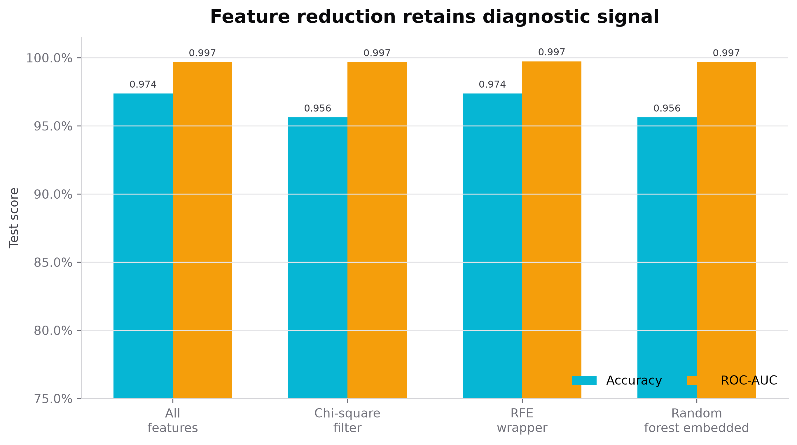
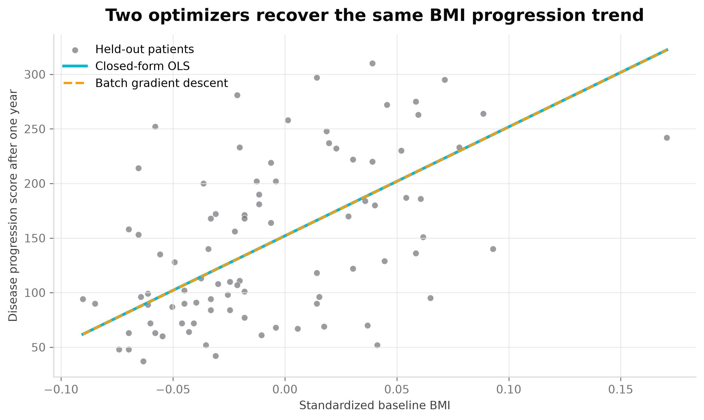
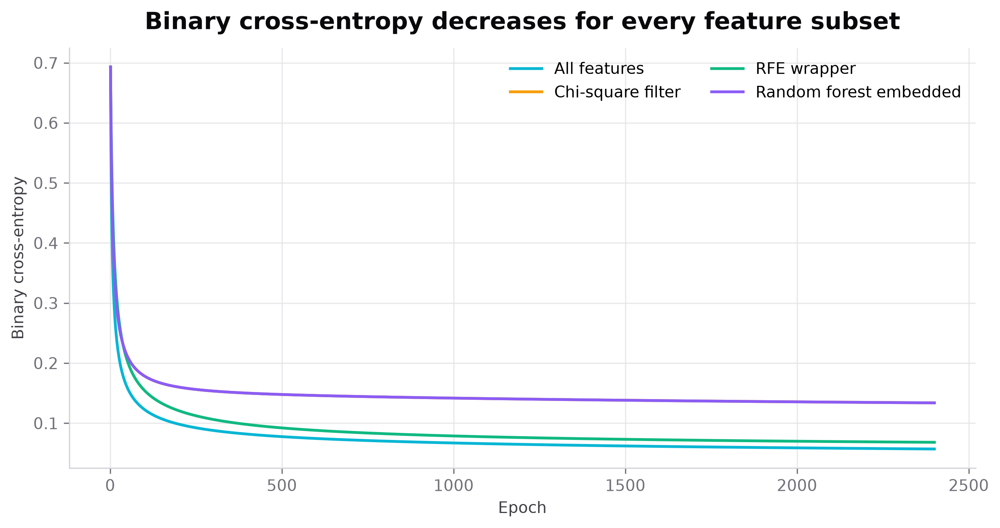
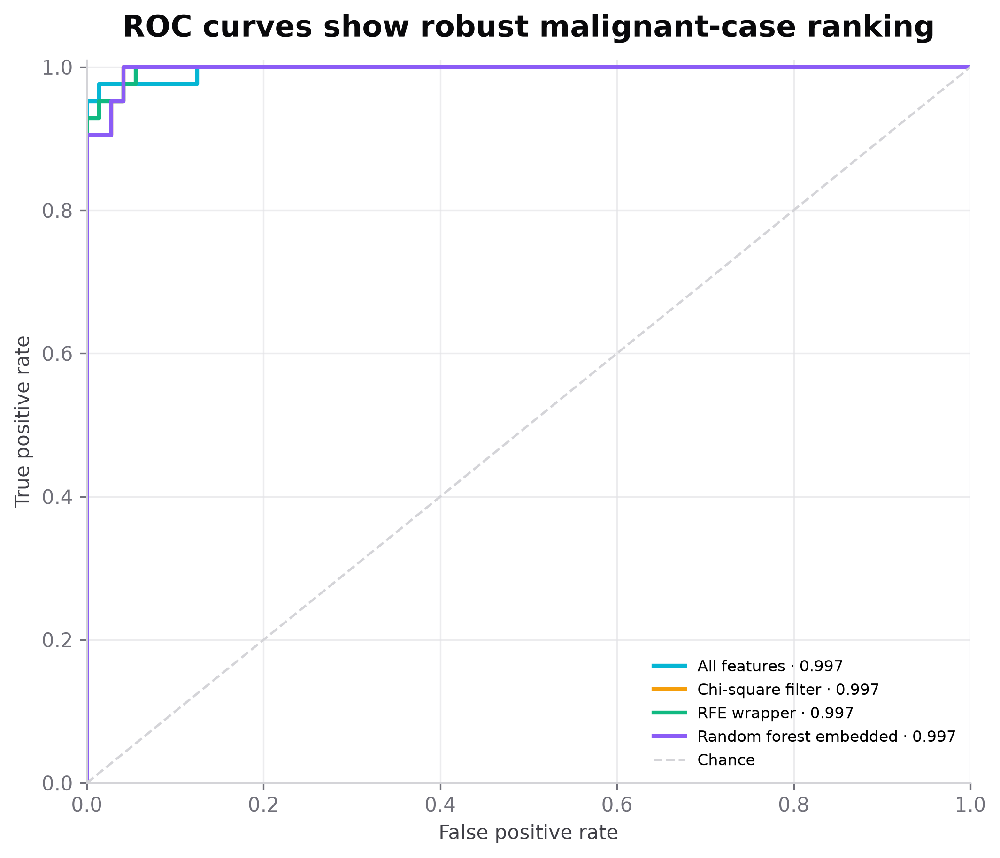

# Kriterion

Kriterion is an auditable machine-learning mini-project that connects feature selection, analytical regression, batch gradient descent, and binary classification in one reproducible clinical benchmark study.

The project is designed for academic evaluation and live explanation. It is not a diagnostic system. Its central question is whether a smaller measurement space can retain classification signal while first-principles optimizers remain numerically consistent with standard library implementations.

## Study design

Two bundled scikit-learn datasets keep the experiment reproducible without a download step.

| Task | Dataset | Samples | Input space | Target |
|---|---:|---:|---:|---|
| Feature selection and classification | Wisconsin Diagnostic Breast Cancer | 569 | 30 morphology measurements | Malignant or benign |
| Regression | Diabetes progression | 442 | Standardized BMI | One-year progression score |

The classification split is stratified 80/20. Every scaler and selector is fitted on training observations only. The same random seed, `42`, controls all reproducible operations.

## Implemented methods

### Feature selection

- Baseline: all 30 measurements
- Filter: chi-square statistical dependence, 10 retained features
- Wrapper: recursive feature elimination with logistic regression, 10 retained features
- Embedded: random-forest impurity importance, 10 retained features

### Regression

The one-variable ordinary least-squares solution is computed directly:

\[
m=\frac{\operatorname{Cov}(x,y)}{\operatorname{Var}(x)},\qquad c=\bar y-m\bar x
\]

Batch gradient descent minimizes mean squared error with complete-data updates for the slope and intercept. A scikit-learn linear model provides a reference result.

### Classification

The scratch logistic implementation uses:

\[
\sigma(z)=\frac{1}{1+e^{-z}}
\]

\[
\mathcal L=-\frac{1}{n}\sum_i\left[y_i\log p_i+(1-y_i)\log(1-p_i)\right]
\]

Weights and bias are updated by batch gradient descent. Predictions use a `0.5` threshold. ROC points are computed from descending probability thresholds and AUC is integrated manually with the trapezoidal rule.

## Measured results

### Scratch logistic regression

| Feature space | Features | Accuracy | Precision | Recall | F1 | ROC-AUC |
|---|---:|---:|---:|---:|---:|---:|
| All features | 30 | 0.9737 | 0.9756 | 0.9524 | 0.9639 | 0.9967 |
| Chi-square filter | 10 | 0.9561 | 0.9744 | 0.9048 | 0.9383 | 0.9967 |
| RFE wrapper | 10 | 0.9737 | 0.9756 | 0.9524 | 0.9639 | **0.9974** |
| Random forest embedded | 10 | 0.9561 | 0.9744 | 0.9048 | 0.9383 | 0.9967 |

RFE retained one third of the original measurements while matching the full-feature accuracy and producing the highest held-out AUC. Its confusion matrix contained 71 true negatives, 40 true positives, 1 false positive, and 2 false negatives.

### Diabetes regression

| Method | MSE | RMSE | MAE | R² |
|---|---:|---:|---:|---:|
| Closed-form OLS | 4061.826 | 63.732 | 52.260 | 0.2334 |
| Batch gradient descent | 4061.826 | 63.732 | 52.260 | 0.2334 |
| Scikit-learn reference | 4061.826 | 63.732 | 52.260 | 0.2334 |

The batch-gradient slope and intercept agree with the analytical solution to numerical precision. The modest R² reflects the intentionally interpretable one-feature formulation.

## Visual evidence

| Feature reduction | Regression agreement |
|---|---|
|  |  |

| Logistic convergence | ROC analysis |
|---|---|
|  |  |

All eight figures are regenerated from `artifacts/results.json`; none contains manually entered metric values.

## Streamlit application

The zinc-themed app contains five study views:

1. Study overview
2. Feature selection
3. Linear regression
4. Logistic regression
5. Reproducibility

Each view combines formulas, measured outputs, and a short interpretation suitable for a live defense. The interface does not accept patient data and does not produce an individual diagnosis.

## Local setup

Python 3.11 or 3.12 is recommended.

```bash
python -m venv .venv
source .venv/bin/activate
python -m pip install --upgrade pip
python -m pip install -e ".[dev]"
python scripts/run_experiments.py
streamlit run app.py
```

The application opens at `http://localhost:8501` by default.

## Streamlit Community Cloud

1. Push the repository to GitHub.
2. Create a Streamlit Community Cloud app from the repository.
3. Set the entry point to `app.py`.
4. Select Python 3.12 when the deployment interface exposes a runtime choice.

`requirements.txt` installs the local package and every runtime dependency. The app can generate the deterministic experiment bundle on first launch if committed artifacts are absent; keeping `artifacts/results.json` in the repository makes the first render faster.

## Docker

```bash
docker build -t kriterion-ml-lab .
docker run --rm -p 8501:8501 kriterion-ml-lab
```

The container includes a health check against Streamlit’s internal health endpoint.

## Reproduce the evidence

```bash
python scripts/run_experiments.py
```

This command writes:

- `artifacts/results.json`
- `artifacts/feature_selection_results.csv`
- `artifacts/classification_metrics.csv`
- `artifacts/regression_metrics.csv`
- eight 300-DPI figures under `assets/figures/`

To rebuild the academic report after the experiment:

```bash
python scripts/build_report.py
```

## Quality checks

```bash
ruff check .
pytest --cov=kriterion --cov-report=term-missing
```

The verified WebPI prototype run passed 17 tests. CI repeats lint, unit/integration tests, coverage, and a Streamlit health smoke test on Python 3.11 and 3.12.

## Repository structure

```text
kriterion-lab/
├── app.py
├── src/kriterion/
│   ├── experiments.py
│   ├── metrics.py
│   ├── models.py
│   ├── ui.py
│   └── visualization.py
├── scripts/
│   ├── run_experiments.py
│   └── build_report.py
├── tests/
├── assets/
│   ├── brand/
│   └── figures/
├── artifacts/
├── content/project.json
└── docs/presentation-structure.md
```

## Limitations

- The datasets are educational benchmarks, not prospective clinical validation cohorts.
- One held-out split does not quantify confidence intervals or site-to-site variation.
- Random-forest impurity importance can favour variables with more possible split points.
- The one-feature regression task prioritizes optimizer transparency over maximum predictive power.
- A `0.5` decision threshold is conventional and is not optimized for a clinical cost function.

## Sources

- W. Wolberg, O. Mangasarian, N. Street, and W. Street, *Breast Cancer Wisconsin (Diagnostic)*, UCI Machine Learning Repository, 1993. https://doi.org/10.24432/C5DW2B
- Scikit-learn `load_diabetes` documentation. https://scikit-learn.org/stable/modules/generated/sklearn.datasets.load_diabetes.html
- F. Pedregosa et al., “Scikit-learn: Machine Learning in Python,” *Journal of Machine Learning Research*, 12, 2825–2830, 2011. https://www.jmlr.org/papers/v12/pedregosa11a.html

## License and citation

The code is released under the MIT License. Academic citation metadata is provided in `CITATION.cff`.
